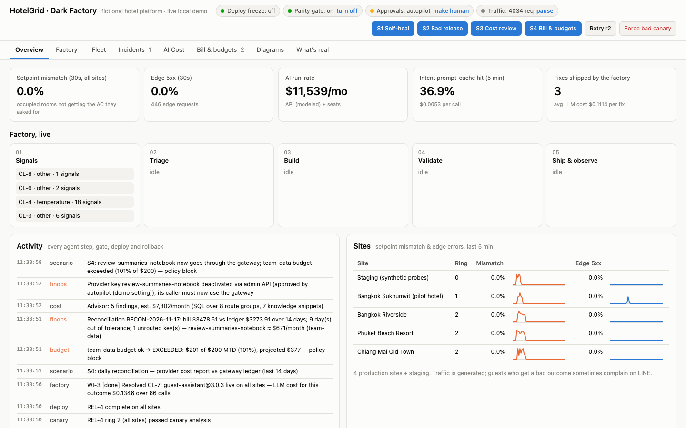
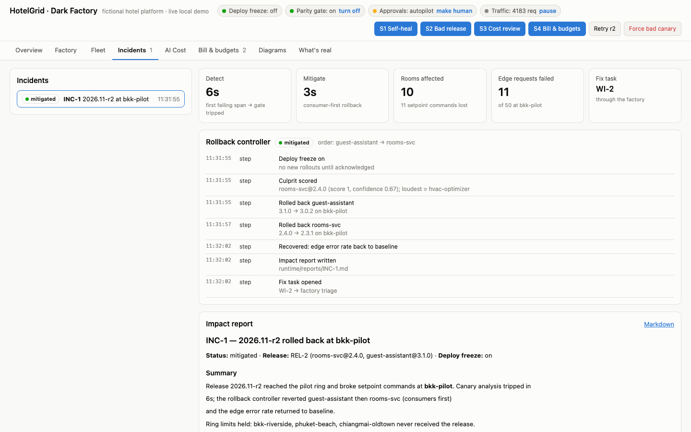
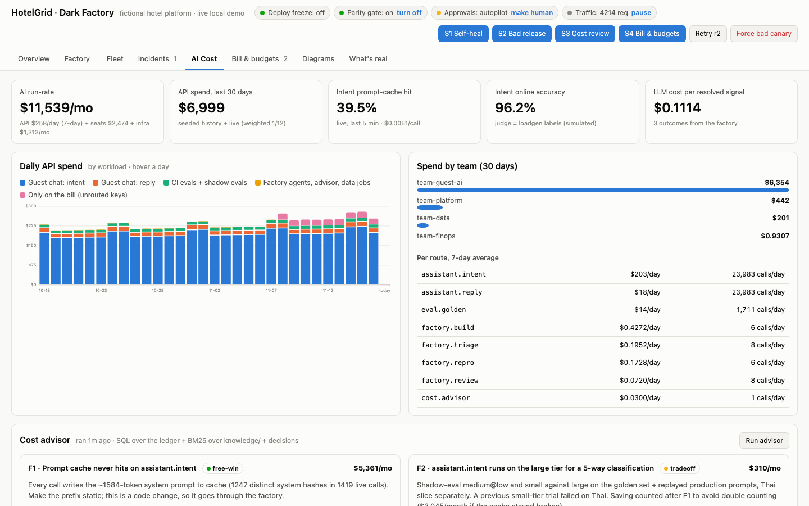
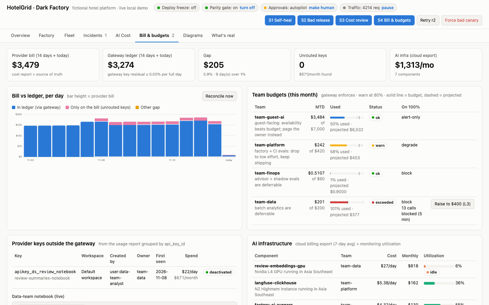
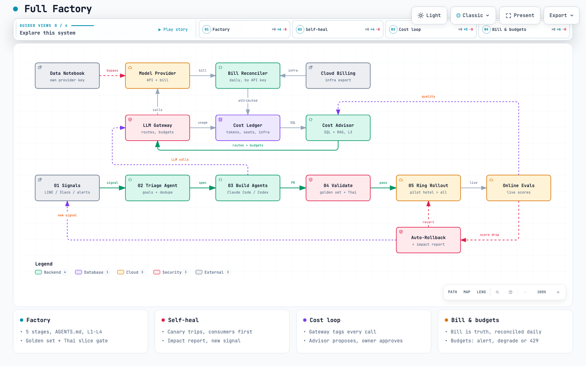

# HotelGrid Software Factory — Demo Brief

A working prototype of a software factory that **fixes production issues from guest feedback**, **rolls back bad
releases across services with an impact report**, and **keeps AI spend measured, attributed and under budget**. It
runs on a fictional five-hotel platform ("HotelGrid") on one laptop, end to end, with real services, real deploys and
real statistics; model outputs and cost history are simulated.

**Status (2026-11-17):** complete and runnable. All four scenarios pass an automated end-to-end run (22/22 checks,
about 5 minutes) and 56 unit and integration tests. Optional real-Claude mode is built and tested against a fake API.

| | Result from the automated run |
|---|---|
| Guest complaints → shipped fix | AC setpoint failures at the pilot hotel **65–80 % → 0 %**, fix shipped through 3 rings, about $0.10 of model spend per fix |
| Bad release across two services | Detected in **6 s**, rolled back in **3 s**, recovered in about 15 s; **3 of 4 production hotels never received it** |
| AI cost review | **$7.3k/month** of savings found on an $11.5k/month modeled run-rate, each with evidence and a citation |
| Bill vs ledger | **$671/month** of spend bypassing the AI gateway found and stopped; gateway metering matches the bill to **0.000 %** |

### The problem it addresses

- **Slow loop from complaint to fix.** Guest feedback (LINE, Slack, in Thai and English) reaches engineers late and
  unstructured; a fix then waits for a release train.
- **Releases break across services.** One service changes a contract, another fails, and the loudest error points at
  the wrong team. Rollback and impact reporting are manual.
- **AI spend is hard to see.** Model calls come from products, internal agents and data jobs; the provider bill does not
  say which team or feature spent what, and nobody enforces budgets.

---

## What the demo shows

Each scenario is one button in the dashboard and runs on live traffic generated across the five hotels.

| Scenario | What happens | Measured outcome |
|---|---|---|
| **S1 Self-heal** | Guests complain the AC ignores them; a metric alert agrees. The factory clusters the signals, triages them with evidence, writes a failing regression test, builds a patch version, runs tests, policy and security checks, AI review and a golden set, waits for approval, then ships staging → pilot hotel → all hotels with a canary gate on every ring. | Setpoint mismatch at the pilot hotel 65–80 % → 0 %. A reply to the complaining guests is queued (LINE, simulated). Model cost of the fix recorded per work item. |
| **S2 Bad release** | A two-service release passes staging (which ran a different version of a third service) and breaks the pilot hotel. | Gate trips in 6 s; deploy freeze; culprit scored correctly (`rooms-svc`, not the loudest service); rollback consumer-first in 3 s; impact report (11 of 50 requests failed, 10 rooms, 10 guests, model spend on failed requests); a fix ships through the factory; the retried release completes. |
| **S3 AI cost review** | An advisor queries the cost ledger, cites internal pricing notes and past decisions, and proposes changes. A cheaper model is shadow-tested on real prompts, with Thai measured separately, then canaried at 25 → 50 → 100 %. | 5 findings worth ≈ $7.3k/month. The prompt-cache fix ships through the factory (cache hit 1 % → 95 %). The smallest model is rejected because Thai accuracy drops 16 points. A forced bad swap auto-reverts. |
| **S4 Bill & budgets** | Daily reconciliation compares the provider's bill (admin API) with the gateway's ledger, per day and per API key. | Finds a data notebook calling the provider directly (≈ $671/month, no tags, no budget). With approval the key is deactivated; the job moves to the gateway, where its team budget blocks it (429). Idle GPU found from the cloud billing export (≈ $655/month). |









---

## How it is built



The demo has twelve processes on localhost talking HTTP. Go runs the hot path and the long-running controllers. Node
runs the dashboard, the agent pipeline and the cost advisor.

| Component | Language | Role |
|---|---|---|
| Control plane + dashboard | Node | Intake and clustering, factory pipeline (triage → spec → build → validate → approve → ship), cost ledger (SQLite) and advisor, live dashboard |
| Release controller | Go | Telemetry from every request, per-hotel versions, ring rollouts with canary statistics, freeze, rollback, culprit scoring, impact reports |
| FinOps service | Go | Team budgets enforced by the gateway, daily bill reconciliation, provider key actions |
| LLM gateway | Go | Every model call: routing, canary arms, per-team tags, pricing, PII redaction, budget enforcement |
| HotelGrid services (5) | Node | The product being fixed: each hotel can run a different version of each service, swapped without restarts |
| Simulators | Node | Model provider with its own bill and admin API, guest traffic and complaints, a rogue data notebook |
| Real-Claude adapter (optional) | Go | Guest-chat calls through the official Anthropic Go SDK; off by default |

**Controls built in:**
- **Approval levels L1–L4.**
  - L1 config changes ship automatically.
  - L2 code fixes need one engineer.
  - L3 contracts and model swaps need the owner and a longer pilot bake.
  - L4 is human-written only.
- **Ring rollout.** Staging, then the pilot hotel, then all hotels, with a canary gate on each ring: error rate
  (z-test), p95 latency, and a business KPI (rooms not getting the AC setpoint they asked for).
- **Deploy freeze** after an incident, plus a **manifest parity gate**, so a release can't reach a hotel whose
  dependent versions differ from what staging tested.
- **Untrusted input.** Guest text is treated as data: PII is redacted, prompt-injection attempts are flagged, and Thai
  is tested as its own slice on every gate.
- **Budgets.** Guest-facing AI is never blocked by a budget (alert only). Internal teams are degraded or blocked.
- **No credentials** are read or stored by the demo. Real-provider modes take keys only from the operator's
  environment.

---

## Evidence and status

**Quality**
- **56 automated tests:**
  - 16 Node tests;
  - 10 app tests;
  - 26 Go tests, run with the race detector;
  - 4 adapter tests.

  They cover:
  - canary statistics, culprit scoring, rollouts and rollbacks;
  - budget policy, reconciliation, PII redaction and prompt-injection flags in English and Thai;
  - parity of the Go ports with the original Node logic.
- **End-to-end smoke run:** all scenarios, the retry and a forced bad canary, 22/22 checks in about 5 minutes,
  repeatable.
- **Gateway overhead:** 0.13 ms per call (p50) in Go, vs 0.22 ms in the earlier Node version, at about 19,000
  requests/second. That's negligible next to a model call.

**Real vs simulated**

| Real | Simulated |
|---|---|
| Processes, HTTP, tracing, metrics, canary statistics, rollback order, culprit scoring | Model outputs and quality (the small model is deliberately weaker in Thai) |
| git worktrees, commits, merges, test runs, golden-set evals | The build agent's patches (scripted fixes stand in for a coding agent) |
| SQLite cost ledger, SQL, retrieval with citations, confidence intervals | 30 days of cost history, seat prices, cloud billing export, GPU utilization |
| Token pricing from list prices, prompt-cache accounting, reports and decision memos | The provider bill and admin API (endpoints follow the public docs), LINE/Slack (local webhooks) |

**Known limitations**
- **Dollar figures are modeled.** They come from seeded history at an assumed production volume (demo traffic runs
  12× faster), using list prices cached on 2026-11-03.
- **Noisy model-swap canary.** It judges each step on about 40 calls with fixed thresholds. In one of four runs it reverted
  a good swap at the 100 % step. Next step: the same significance test the release gate already uses.
- **Real-Claude mode** is tested against a fake API only. It has not been run against the live API.
- **Single machine.** The dashboard has no authentication and is meant for local use only.

---

## Next steps to production

Each simulated part has a named replacement. This list is the integration backlog.

| Today | Production | Status |
|---|---|---|
| Simulated model for guest chat | Claude API | Built: `LLM_PROVIDER=anthropic` (official Go SDK, refusal fallback, prompt caching); needs an API key |
| Scripted build agent | Claude Code (headless) in the work item's worktree | Same gates and approvals; replace one step |
| Gateway + ledger | LiteLLM or Portkey + Langfuse | Keep the tag headers; send rows as generations; read scores back for canaries |
| Release controller rollouts | Argo Rollouts / Argo CD | Rings = sites; keep culprit scoring and impact reports as a service beside it |
| Telemetry store | OpenTelemetry → Tempo / Datadog | Spans already carry trace and parent IDs |
| AI code review gate | cubic (or similar) | Call from the Validate stage |
| Local LINE/Slack webhooks | LINE Official Account, Slack app | Point webhooks at intake; add signature checks |
| Simulated bill | Anthropic Usage and Cost API | Adapter written; needs an admin key; move to the newer Usage and Cost Analytics API |
| Simulated cloud export | BigQuery billing export / AWS CUR | Load daily into the `infra` table |

---

## Running and presenting the demo

**Requirements:** macOS (tested; Linux should work), Node 22.5+, Go 1.24+, git. No packages to install; Chrome is needed only for
screenshots.

```bash
cd demo
npm start            # builds the Go services, starts everything → http://127.0.0.1:4000
npm run reset        # same, from a clean state
npm run smoke        # unattended end-to-end check of all scenarios (stop the demo first)
npm test             # all unit and integration tests
```

**10-minute walkthrough**
1. **Overview (1 min).** Five hotels with live traffic. The pilot hotel shows 65–80 % setpoint failures: the
   planted bug. Point at the guest complaints arriving in Thai and English.
2. **S1 (3 min).** Press *S1 Self-heal*, then open *Factory*: triage evidence, failing test, spec, diff, gates. Approve
   when it asks (the approval stays human by default). Watch the rings, then the KPI drops to 0 %.
3. **S2 (2 min).** Press *S2 Bad release*, then open *Incidents*: detect and mitigate times, rollback order, impact
   report. Then *Fleet*: the other hotels never got the release.
4. **S3 (2 min).** Press *S3 Cost review*, then open *AI Cost*: findings with savings and citations, shadow
   evaluation (the Thai slice blocks the cheapest model), the canary steps.
5. **S4 (1 min).** Press *S4 Bill & budgets*: bill vs ledger, the unrouted key, deactivation, the budget block.
6. **Diagrams (1 min).** The *Full factory* diagram, as the summary.

The *Approvals* pill switches human/autopilot; *Force bad canary* shows an automatic revert on demand.

**Folder contents**

```
hotelgrid-demo/
├── README.md, README.pdf   this brief
├── images/                 screenshots used here
├── diagrams/               interactive architecture diagrams
└── demo/                   runnable demo (demo/README.md = technical guide)
    ├── app/                HotelGrid product repo the agents fix
    ├── config/             hotels, rings, routes, budgets, prices
    ├── knowledge/          cost advisor notes and past decisions
    ├── platform/           control plane, dashboard, simulators (Node)
    ├── go/                 release controller, finops, gateway (Go)
    ├── scripts/            start, smoke test, scenarios, benchmark
    └── test/               Node tests (Go tests sit with Go code)
```
